<h1 align="center"><a href="https://davy45270.github.io/Opencade/">▶ Play / Jouer</a></h1>

<p align="center"><a href="https://davy45270.github.io/Opencade/">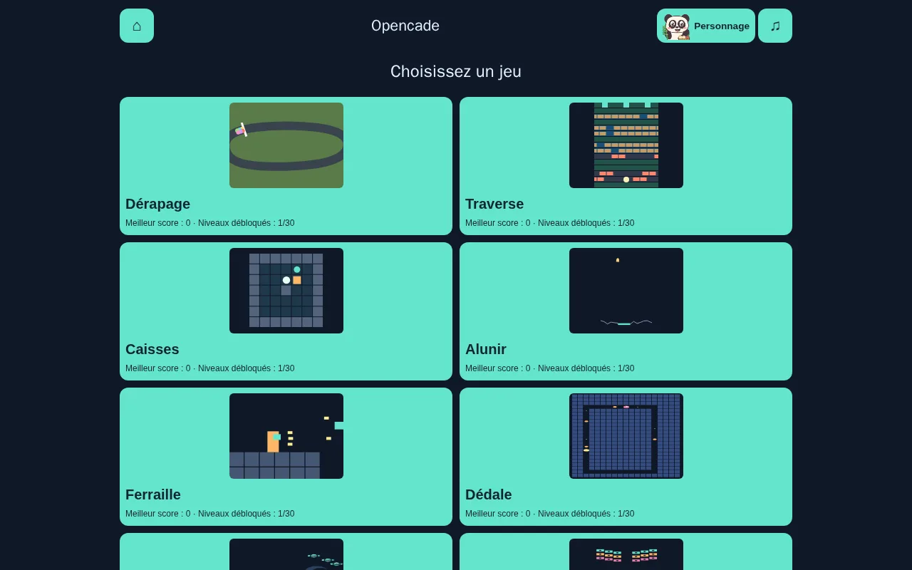</a></p>

[English](README.md) | Français

Alunir propose 30 situations écrites et 12 mécaniques, du cargo aux grottes et aux quais mobiles, vérifiées par 180 vols déterministes (passe 106).

Ferraille propose 30 parcours écrits et 16 modules physiques, avec mesure de répétition ordonnée et 900 rejeux gagnants pour les cinq personnages (passe 103).

La passe 101 enrichit Essaim de cinq signatures mécaniquement distinctes, de grands vaisseaux procéduraux, de sept silhouettes ennemies et de trois décors spatiaux, avec rejeux historiques préservés.

La passe 84 ajoute les spéciaux des compagnons à Ferraille, Briqueterie et Essaim, avec contrôles aux deux pouces et tir automatique mémorisé dans Essaim.

Passe 82 : le compagnon choisi explore Dédale, pilote Orbite et guide Empilo, avec Lueur, Rafale et Mise de côté, vérifiés par rejeux Node déterministes.

La spécification détaillée des jeux, [GAME_SPEC.md](GAME_SPEC.md), est en français.

# Opencade

Le compagnon choisi joue dans Caisses, Traverse, Alunir, Dérapage, Bubble Lab et Serpentin, avec dessins procéduraux partagés, réactions et spéciaux tactiques de même puissance.

Ferraille propose 30 étapes avec six comportements ennemis, flammes/ricochets/grenades, wagonnet, otages et gardiens à faiblesse, dont un réacteur en trois phases.

[](https://github.com/Davy45270/Opencade/actions/workflows/ci.yml)
[](https://github.com/Davy45270/Opencade/actions/workflows/pages.yml)
[](LICENSE)

Treize jeux originaux réunis dans une arcade pour navigateur. Opencade se joue
sur téléphone et ordinateur, au toucher, à la souris et au clavier, sans compte
ni serveur applicatif. Le projet utilise TypeScript strict, Phaser 3 et Vite.
**L’interface est en français.**

**[Jouer à la démo](https://davy45270.github.io/Opencade/)**

L’accueil présente treize vignettes Canvas animées par les moteurs purs des jeux.
Elles se suspendent hors écran, en arrière-plan et pendant une partie. La
réduction des animations les remplace par des images fixes. Sur téléphone,
la grille comporte deux colonnes.

## Captures d’écran

Captures en portrait sur téléphone, prises en cours de partie (`node scripts/screenshots.js` les régénère après `npm run build`).

<table>
<tr>
<td align="center" width="33%">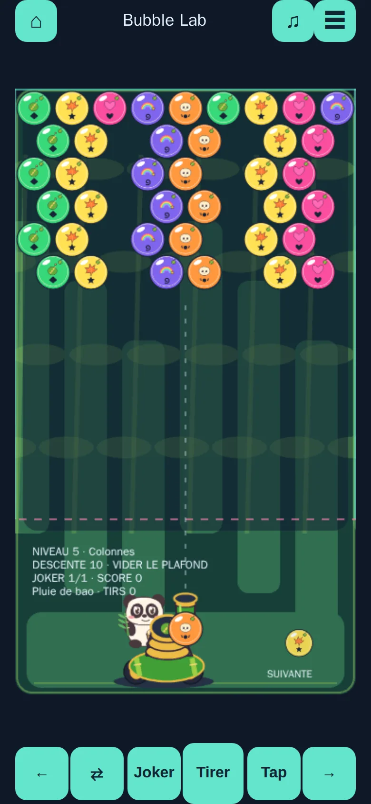<br><b>Bubble Lab</b><br>Éclater des groupes de trois bulles avant que le plafond ne descende.</td>
<td align="center" width="33%">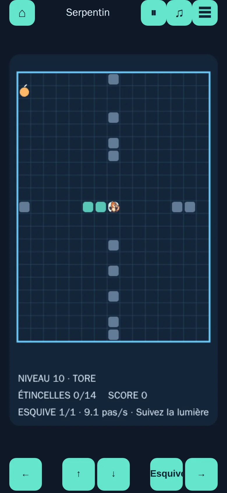<br><b>Serpentin</b><br>Allonger une traînée lumineuse en récoltant étincelles et cristaux.</td>
<td align="center" width="33%">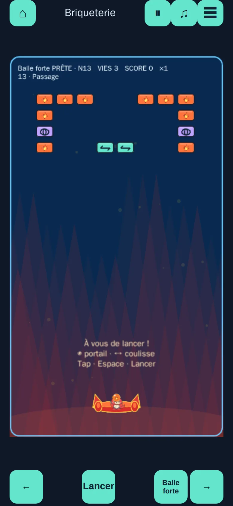<br><b>Briqueterie</b><br>Casser 30 murs dessinés, avec portails, clés et multibille.</td>
</tr>
<tr>
<td align="center" width="33%">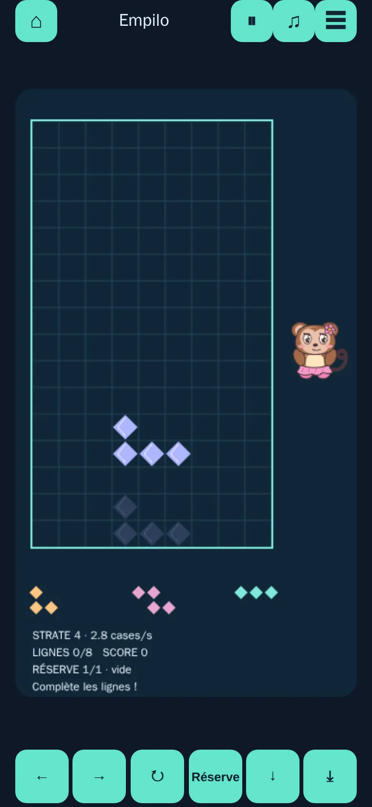<br><b>Empilo</b><br>Caser des pièces de cristal dans le puits et compléter les lignes.</td>
<td align="center" width="33%">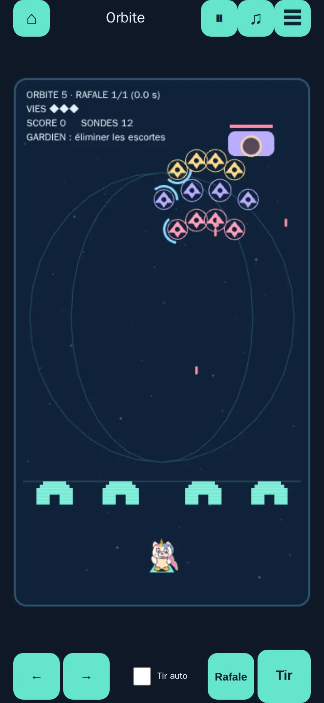<br><b>Orbite</b><br>Repousser trente formations et six gardiens depuis l’orbite.</td>
<td align="center" width="33%">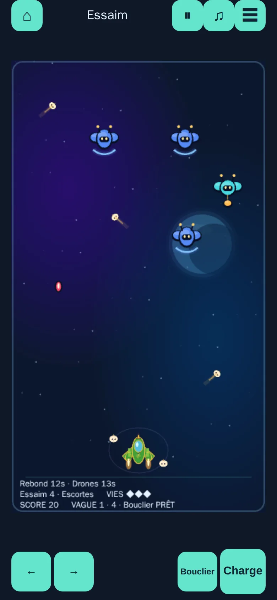<br><b>Essaim</b><br>Traverser des étapes tactiques avec six armes et des vaisseaux à sauver.</td>
</tr>
<tr>
<td align="center" width="33%">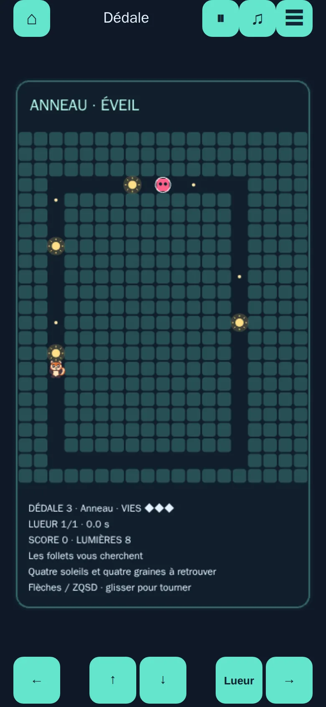<br><b>Dédale</b><br>Ramasser les graines du labyrinthe, puis chasser les feux follets.</td>
<td align="center" width="33%">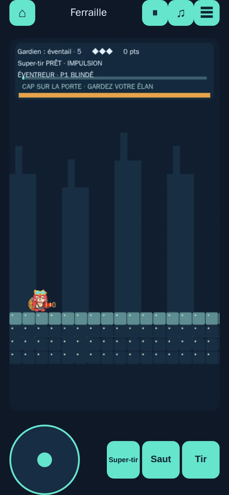<br><b>Ferraille</b><br>Courir, sauter et tirer à travers les ateliers et leurs gardiens.</td>
<td align="center" width="33%">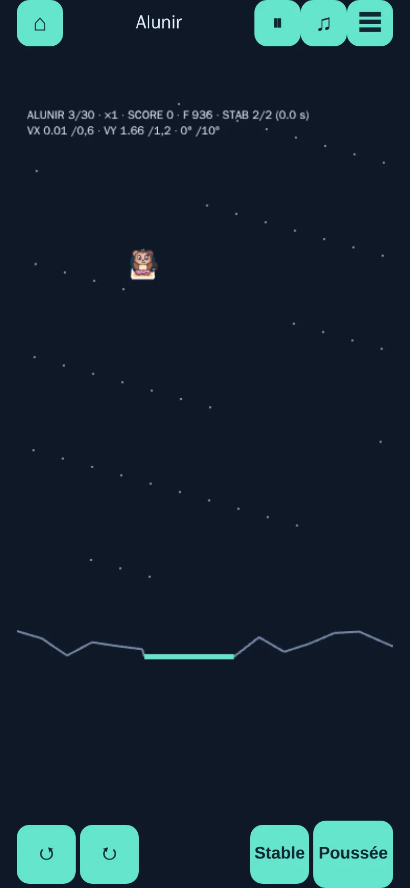<br><b>Alunir</b><br>Poser le module en douceur malgré les rafales et le peu de carburant.</td>
</tr>
<tr>
<td align="center" width="33%">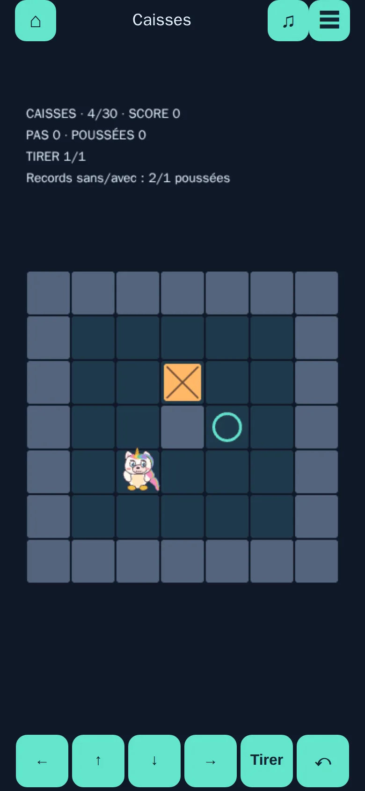<br><b>Caisses</b><br>Pousser les caisses sur leurs cibles, avec annulation illimitée.</td>
<td align="center" width="33%">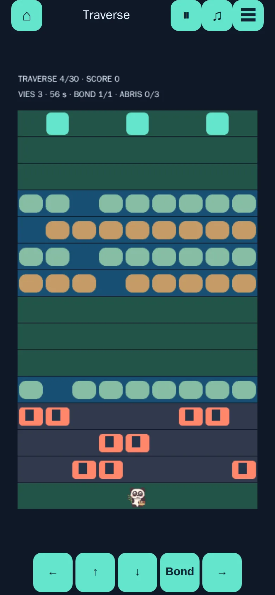<br><b>Traverse</b><br>Rejoindre les abris à travers la circulation, les troncs et les flotteurs.</td>
<td align="center" width="33%">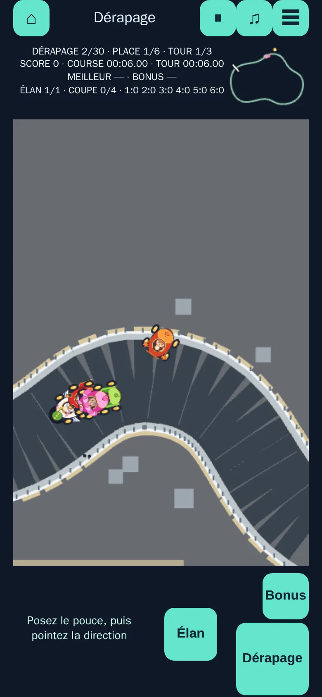<br><b>Dérapage</b><br>Faire déraper un kart sur 30 circuits et viser le podium.</td>
</tr>
</table>

## Jeux et contrôles

Bubble Lab propose un accrochage hexagonal précis, des tirs dans les trous, des bonus de chute et la visée par glisser-relâcher ; ⇄ ou X échange la prochaine bulle.

Bubble Lab propose désormais 30 niveaux sculptés avec pierres, bombes, tirs arc-en-ciel, glace, étoiles à libérer et butoirs internes. Le tableau
indique les commandes clavier et tactiles de chaque jeu, ainsi que les commandes
souris disponibles. Les boutons à l’écran sont également cliquables. P ou Échap
met les jeux en temps réel en pause. Chaque jeu possède son aide ; sur téléphone,
le menu ☰ ouvre le statut, l’aide, les niveaux et le redémarrage en mettant la
partie en pause.

| Jeu | Principe | Contrôles |
|---|---|---|
| **Le Collier du Singe** | 30 niveaux de perles en chaîne, reculs aimantés et combos. | Viser partout puis relâcher ; tap tireur ou ⇄/X : échanger ; flèches/Espace : viser/tirer ; P/Échap : pause. |
| **Bombercade** | Trente labyrinthes de bombes en solo, blocs cassables, quatre arènes et compagnon choisi. | Flèches / ZQSD : marcher ; Espace : bombe ; X : pouvoir ; pavé tactile et boutons. |
| **Bubble Lab** | Former des groupes d’au moins trois bulles de même couleur avant que le plafond ne descende. | Souris : viser et tirer ; doigt : glisser puis relâcher ; flèches : viser ; Espace : tirer ; boutons tactiles : ajuster et tirer. |
| **Serpentin** | Allonger une traînée lumineuse en récoltant étincelles et cristaux, entre murs ou sur un tore. | Flèches, ZQSD ou WASD ; toucher : glisser ou croix directionnelle. |
| **Briqueterie** | 30 murs dessinés : coulisses, explosions, repousse, portails, chicanes, angles, clés, multi-balle, gravité inversée et suspensions. | Souris : guider ; Gauche/Droite ou A/D : déplacer ; Espace : lancer ; toucher : glisser en bas, tap ou bouton Lancer. |
| **Empilo** | Placer des pièces de cristal dans un puits de 9 × 16 et compléter des lignes, dont certaines sont scellées. | Gauche/Droite/Bas : déplacer ; X/W/Haut et Z/C : tourner ; Espace : chute ; toucher : glisser, tap pour tourner, glisser vite vers le bas pour lâcher. |
| **Orbite** | Trente formations : rotors, sondes scindées, astéroïdes, gravité, furtives, réparateurs, satellite et essaim coordonné ; six gardiens et un final en deux phases. | Souris : guider ; Gauche/Droite ou A/D : déplacer ; Espace : tirer ; toucher : glisser en bas et maintenir Tir, ou activer Tir auto. |
| **Essaim** | Trente niveaux de formations tactiques, six armes ramassables, sauvetages et six boss. | Souris : guider et tirer ; Gauche/Droite ou A/D : déplacer ; Espace ou Tir : maintenir, relâcher pour la charge ; toucher : glisser en bas. |
| **Dédale** | Récolter les graines d’un labyrinthe en échappant à quatre follets, puis les rendre vulnérables avec un soleil. | Flèches ou ZQSD ; toucher : glisser ou croix directionnelle. |
| **Ferraille** | Traverser des ateliers en courant, sautant et tirant, avec un gardien à phases tous les cinq niveaux. | Gauche/Droite ou A/D : courir ; Haut/W et Bas/S : viser ou s’accroupir ; Espace/Z : saut ; X/J : tir ; toucher : joystick, Saut et Tir maintenus. |
| **Alunir** | Poser doucement un module lunaire en dosant rotation, poussée et carburant, entre relief et rafales. | Haut/W : poussée ; Gauche/Droite ou A/D : rotation ; toucher : maintenir les boutons de rotation et Poussée. |
| **Caisses** | Pousser une à six caisses sur leurs cibles, avec annulation illimitée et records prouvés par solveur. | Flèches ou Q/S/D et Maj+Z : déplacer ; Z/Retour arrière : annuler ; R : recommencer ; toucher : glisser ou croix, bouton Annuler. |
| **Traverse** | Rejoindre les abris entre trafic routier, rondins mobiles et flotteurs plongeants. | Flèches ou ZQSD : un pas ; clic souris ou tap : monter ; glisser ou croix : un pas. |
| **Dérapage** | Piloter un kart, charger les dérapages et viser le podium en sept coupes originales. | Flèches : direction absolue et diagonales ; Espace/Maj : dérapage ; X/Ctrl : bonus ; toucher : poser le joystick 360° partout sur la vue de piste (zone morte 10 px), pointer où aller, relâcher pour garder le cap ; Dérapage 88 px et Bonus 56 px ; caméra tournante et braquage relatif disponibles dans ☰. |

Dérapage propose 30 tracés dessinés à la main, des thèmes par coupe, un damier sur toute la largeur et une preuve de diversité géométrique.

Dérapage affiche les chronos de course et de tour en temps de simulation, le meilleur tour, les écarts colorés et les records par circuit conservés après rechargement. Le HUD mobile reste au-dessus de la piste ; le résultat récapitule temps et classement. Z28/Z29 couvrent le rejeu et la persistance tolérante aux erreurs.

Les noms, règles, niveaux, graphismes et sons sont originaux. Les graphismes et
sons synthétisés sont produits par le code, sans ressource de jeu externe,
police ni fichier audio. Les icônes PWA originales sont également produites par
code. Meilleurs scores, niveaux débloqués et préférences utilisent `localStorage`
quand il est disponible ; le jeu fonctionne sans. Les clés historiques
`arcade-lab:*` et `bubble-lab:*` préservent les progrès existants.

## Installer sur téléphone et jouer hors ligne

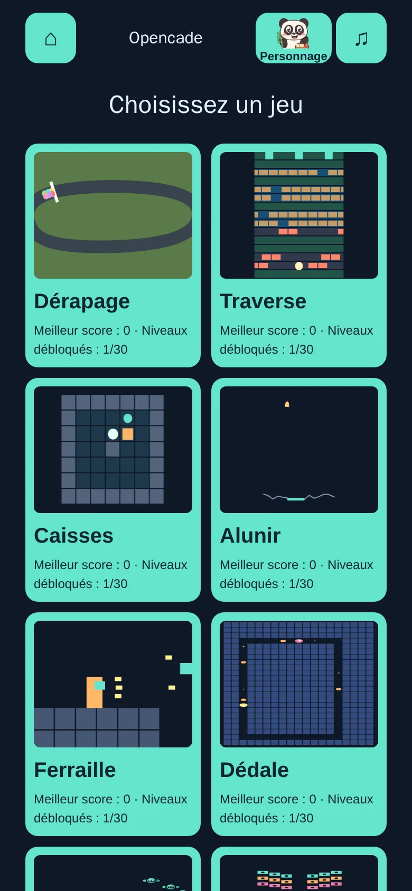

Ouvrir [la démo](https://davy45270.github.io/Opencade/) avec une connexion et
attendre le chargement complet de l’accueil pour mettre les treize jeux en cache.

- **Android / Chrome :** ouvrir le menu ⋮ et choisir « Installer l’application » ou « Ajouter à l’écran d’accueil ».
- **iOS / Safari :** ouvrir Partager, choisir « Sur l’écran d’accueil » et confirmer.

Relancer Opencade depuis la nouvelle icône. Les intitulés varient selon la
version du navigateur. Une fois le cache initial prêt, l’accueil et les douze
jeux fonctionnent hors ligne. Scores, niveaux débloqués et préférences restent
dans le stockage local du navigateur ou de l’application installée. Effacer ce
stockage supprime les progrès et peut imposer un nouveau chargement en ligne.

Les mises à jour sont annoncées sans interrompre la partie. Fermer toutes les
fenêtres Opencade puis relancer pour appliquer une mise à jour disponible. Le
service worker attend le prochain lancement sans forcer son activation pendant
le jeu. Tous les fichiers HTML, JavaScript, CSS et icônes du build sont
précachés, Phaser compris ; aucune police distante, aucun serveur tiers ni cache
de données externes n’est utilisé.

## Confort sur téléphone

Quand le navigateur le permet, l’écran reste allumé pendant le jeu actif et est
libéré en pause, en arrière-plan ou à la fin du niveau. Des vibrations signalent
perte de vie, victoire et défaite si le son global est activé. Le menu mobile
propose le plein écran et tente l’orientation portrait. Ces fonctions facultatives
restent silencieuses si elles sont indisponibles ou refusées. Voir la section
Appareil de [GAME_SPEC.md](GAME_SPEC.md).

## Développement

Utiliser **Node 22.12 ou plus** (voir `.nvmrc`).

```sh
npm ci
npm run dev        # serveur de développement
npm run lint       # ESLint, aucun avertissement toléré
npm run typecheck  # vérification TypeScript sans émission
npm test           # tests Vitest des moteurs et du socle
npm run build      # site statique dans dist/
npx playwright install --with-deps chromium
npm run test:e2e   # Playwright sur le build de production
node scripts/check-pwa-mutations.js # assertions PWA + huit mutations, sans navigateur ni Vitest
npm run preview    # aperçu de dist/ par HTTP
```

Le build est un site statique autonome. Les chemins relatifs (`base: './'`)
permettent de le servir à la racine ou dans un sous-répertoire comme `/Opencade/`.
Utiliser HTTP, sans ouvrir directement les fichiers. Le manifeste et le service
worker utilisent aussi des chemins relatifs. Les trois icônes livrées (192, 512
et 512 maskable) ont un fond opaque et un motif central dans la zone de sûreté
maskable ; le build ne nécessite aucun outil graphique.

Vitest vérifie les règles sur des grilles et graines fixées, selon les
identifiants de [GAME_SPEC.md](GAME_SPEC.md). Playwright couvre Chromium bureau
et mobile tactile, utilise de vraies entrées et échoue à la moindre erreur de
page ou de console. Le paramètre d’URL de test `?test=1` expose
`window.__ARCADE_TEST__` et les crochets propres aux jeux : état, niveaux,
scénarios et `advance(ms)`. Avancer le temps du moteur rend les assertions de jeu
indépendantes de la vitesse de rendu. Sans ce paramètre, les crochets sont
absents. Ils restent volontairement dans le build publié pour tester le produit
livré ; modifier l’état d’une partie locale n’est pas une frontière de sécurité.

GitHub Actions exécute lint, typecheck, tests unitaires, build et E2E sur les push
et pull requests, et joint le rapport Playwright en cas d’échec.

## Architecture

```text
src/
  engines/<jeu>/    règles, collisions, niveaux et score purs
  engines/shared/   générateur pseudo-aléatoire à graine
  games/<jeu>/      scène Phaser, animation, entrées et sons synthétisés
  games/registry.ts liste des jeux, aides et contrôles déclarés
  shell/            entrées, pause, menus, niveaux, son et stockage partagés
tests/              tests unitaires des moteurs et du socle
tests/e2e/          parcours navigateur bureau et mobile
```

Les moteurs sont du TypeScript pur, sans Phaser ni DOM. ESLint y interdit les
globales du navigateur et `Math.random`. Un générateur pseudo-aléatoire à graine
reproduit exactement la même partie pour les mêmes entrées et la même graine.
Les scènes Phaser dessinent l’état du moteur et lui transmettent les entrées.
Le socle recrée Phaser lors des changements de jeu et libère les écouteurs à la
fermeture. Pour ajouter un jeu, créer un moteur et une scène originaux, puis les
déclarer dans `src/games/registry.ts`.

## Limites connues

- Pas de classement en ligne ni de sauvegarde de partie en cours.
- Le canevas n’offre pas une représentation complète aux lecteurs d’écran ; score, statut et boutons sont en HTML.
- Les tests navigateur automatiques couvrent uniquement Chromium.
- Vite signale la taille du paquet Phaser ; cet avertissement est attendu.

## Crédits

Code écrit par Codex (OpenAI), relu et vérifié par Claude (Anthropic), sous la
direction de David Sevin.

## Contribuer

Les signalements et pull requests sont les bienvenus en anglais ou en français.
Consulter [CONTRIBUTING.md](CONTRIBUTING.md), le [code de conduite](CODE_OF_CONDUCT.md)
et la [politique de sécurité](SECURITY.md) avant de contribuer.

## Licence

[MIT](LICENSE) © 2026 David Sevin. Phaser est également distribué sous licence MIT.

Dérapage ajoute les portes de slalom avec pénalités, la neige et la gravité en descente, les virages relevés et sauts BMX et les rails urbains continus.

Validation Essaim (armes, diversité, 60 victoires et mutations) : `nice -n 19 ionice -c3 node scripts/validate-essaim.js`. Les captures E2E sont réservées à l’hôte de test.

Dédale, passe 57 : clés/portes colorées, sens uniques, portails, interrupteurs, murs cycliques, glace et ombres dans cinq formes à graine. Trente solutions enregistrées et six mutations sont vérifiées par `nice -n 19 ionice -c3 node scripts/validate-dedale.js`. Répétitivité : 100 → 22,4, clones adjacents : 0 %. Voir [les trente niveaux](GAME_SPEC.md#dédale).

Briqueterie (passe 61) : campagnes enregistrées gagnantes sur les graines 455 et 28 ; validation sans navigateur avec `nice -n 19 ionice -c3 node scripts/validate-briqueterie.js`. Détails des trente formes dans `GAME_SPEC.md`, mesures dans `docs/diversity.md`.

Orbite (passe 64) : régénérer/vérifier les 60 victoires par commandes normales avec
`nice -n 19 ionice -c3 taskset -c 0,1 node scripts/validate-orbite.js`
(`--record` pour régénérer). Chaque test rejoue un enregistrement court ; les campagnes longues restent dans Node.

Dérapage (passe 67) propose par défaut un joystick au nord fixe avec cap visible, aide légère désactivable, rails sans collage et premier circuit large ; les records migrent par nom de circuit.

Le compagnon choisi sur l'accueil joue désormais dans Caisses, Traverse et Alunir, avec un spécial tactique et des animations dessinées par le code.

### Personnages

| Identifiant | Nom et sous-titre | Devise |
| --- | --- | --- |
| `panda` | **Boubou** — Panda glouton | « Manger, foncer, recommencer ! » |
| `pandaroux` | **CaliRoux** — Panda roux joueur et câlin | « Des câlins et des dérapages ! » |
| `dragon` | **Pestouille** — Dragon assidu | « Toujours plus loin, toujours plus fort ! » |
| `singe` | **Tutu** — Singe en tutu | « Des pirouettes plein la piste ! » |
| `licorne` | **Lumi** — Licorne joueuse | « La magie au service de la victoire ! » |

Le choix du personnage affiche son nom, son sous-titre et sa devise.

**Le Collier du Singe** (`collier`), treizième jeu : 30 niveaux de perles en chaîne ; viser partout et relâcher pour tirer, tap sur le tireur ou ⇄/X pour échanger. Validation Node : `npm run test:node -- --only=validate-collier.js`.

Gourmandises ajoute 180 niveaux à graine, deux modes, des spéciaux, des objets dorés, de la glace double, du chocolat qui s’étend, des fleurs prisonnières et des tapis bouclés ; équilibre sur cinq graines, états inchangés des niveaux 1–120 et 45 mutations en mémoire.

**Les Artificiers** (`artificiers`) : trente duels au tour par tour, cibles
d’entraînement et missions de survie ou de démolition, dans un archipel vert,
des falaises automnales et une cuvette volcanique. Glisser depuis le compagnon
actif, relâcher pour tirer. Marche courte, saut, grappin, six armes à munitions
limitées, vent visible et eau montante ; solo contre trois degrés d’IA ou deux
joueurs sur le même téléphone. Node rejoue trente victoires enregistrées et
les victoires tactiles bruitées des niveaux 1 et 10. Dessins et sons en code.
