<h1 align="center"><a href="https://davy45270.github.io/Opencade/">▶ Play / Jouer</a></h1>

Petits Pompiers: rescue neighbours and animals with five firefighters, touch controls and relaxed or challenge modes.

<p align="center"><a href="https://davy45270.github.io/Opencade/">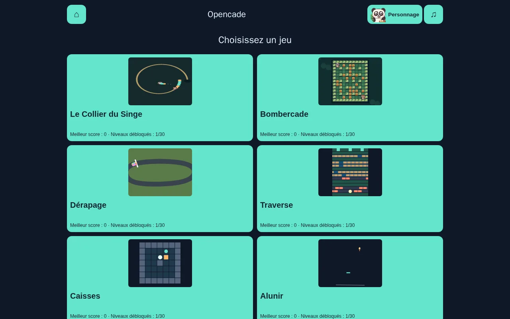</a></p>

English | [Français](README.fr.md)

Alunir now has 30 authored situations and 12 mechanics, from cargo runs to caves and moving pads, verified by 180 deterministic flights (pass 106).

Ferraille now has 30 authored courses and 16 physical terrain modules, with ordered gameplay repetition checks and 900 winning character replays (pass 103).

Pass 101 gives Essaim five mechanically distinct character signatures, larger procedural ships, seven enemy silhouettes and three space themes, preserving historical replays.

Pass 84 adds character specials to Ferraille, Briqueterie and Essaim, with two-thumb controls and remembered default autofire in Essaim.

Pass 82: the selected companion explores Dédale, pilots Orbite and guides Empilo, with Light, Burst and Hold specials and deterministic Node replay coverage.

The detailed game specification, [GAME_SPEC.md](GAME_SPEC.md), is in French.

# Opencade

The selected companion now plays in Caisses, Traverse, Alunir, Pistouille, Bubble Lab and Serpentin, with shared procedural art, reactions and equally balanced tactical specials.

Ferraille now spans 30 authored stages with six enemy behaviors, flame/ricochet/grenade pickups, wagon rides, hostage rescues and vulnerable multi-phase guardians.

[](https://github.com/Davy45270/Opencade/actions/workflows/ci.yml)
[](https://github.com/Davy45270/Opencade/actions/workflows/pages.yml)
[](LICENSE)

Original games, one browser arcade. Opencade runs on phones and desktops,
with touch, mouse and keyboard controls and no account or backend. It is built
with strict TypeScript, Phaser 4 and Vite. **The interface is in French.**

**[Play the demo](https://davy45270.github.io/Opencade/)**

Every card on the home screen shows an animated Canvas preview driven by the games'
pure engines. Previews pause off screen, in the background and during play;
reduced-motion preferences switch them to still images. Phones use a two-column grid.

## Screenshots

Phone portrait captures taken during play (`node scripts/screenshots.js` regenerates them after `npm run build`).

<table>
<tr>
<td align="center" width="33%">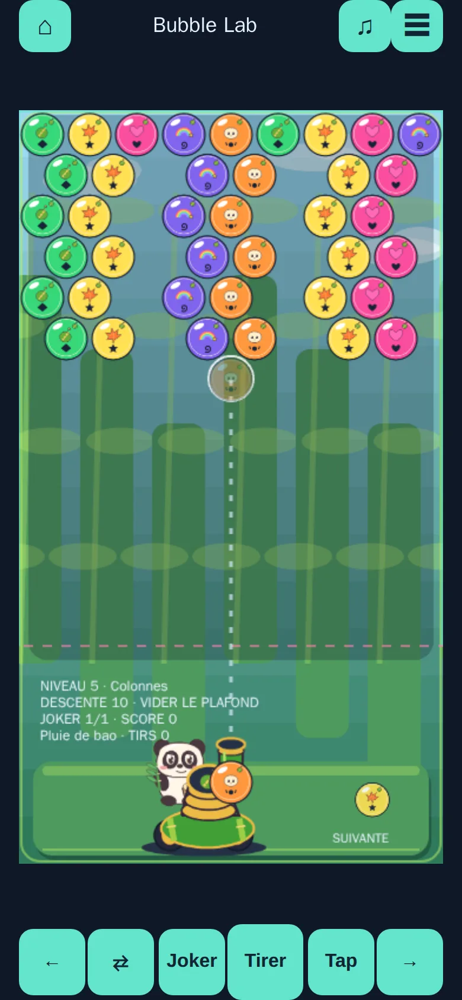<br><b>Bubble Lab</b><br>Pop groups of three matching bubbles before the ceiling drops.</td>
<td align="center" width="33%">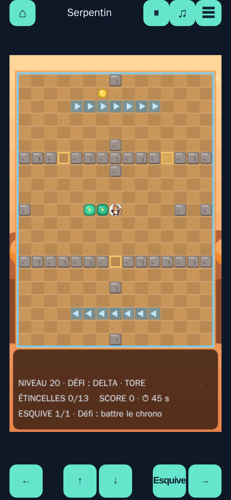<br><b>Serpentin</b><br>Grow a glowing trail by collecting sparks and crystals.</td>
<td align="center" width="33%">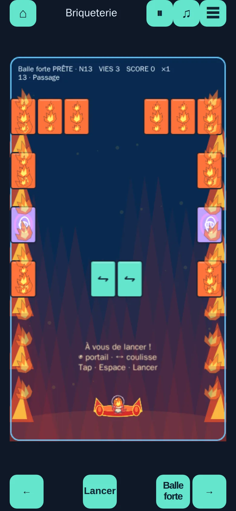<br><b>Briqueterie</b><br>Break 30 authored walls with portals, keys and multiball.</td>
</tr>
<tr>
<td align="center" width="33%">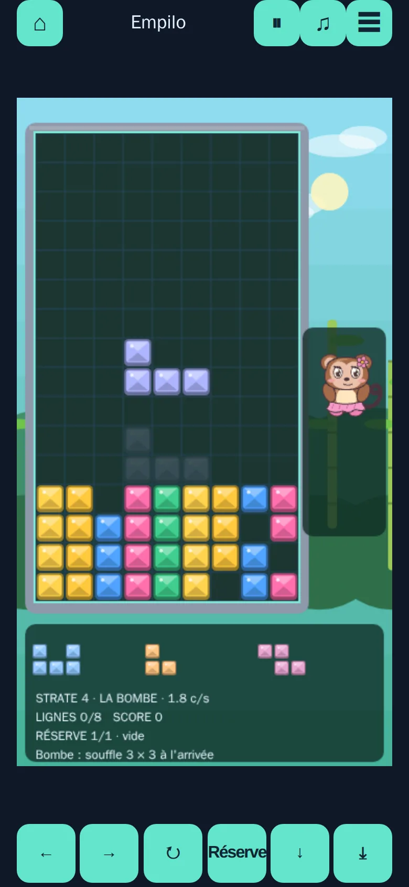<br><b>Empilo</b><br>Fit crystal pieces into the well and clear rows.</td>
<td align="center" width="33%">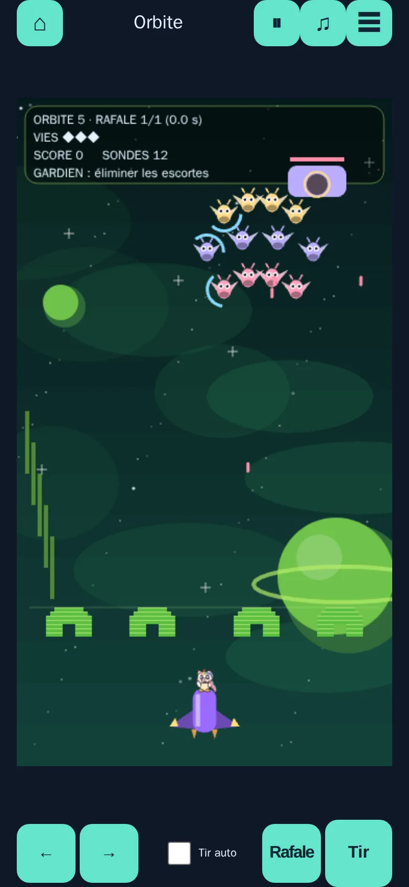<br><b>Orbite</b><br>Hold off thirty formations and six guardians from orbit.</td>
<td align="center" width="33%">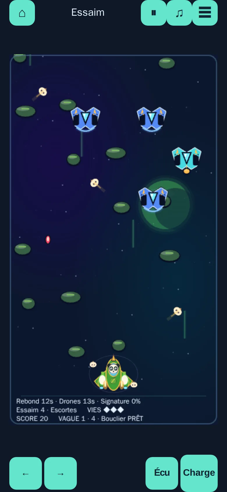<br><b>Essaim</b><br>Fly through tactical stages with six weapons and rescue ships.</td>
</tr>
<tr>
<td align="center" width="33%">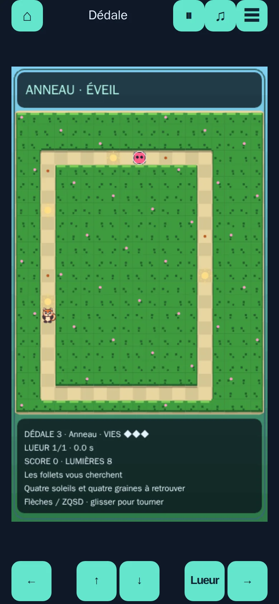<br><b>Dédale</b><br>Gather seeds in a maze, then turn the tables on the wisps.</td>
<td align="center" width="33%">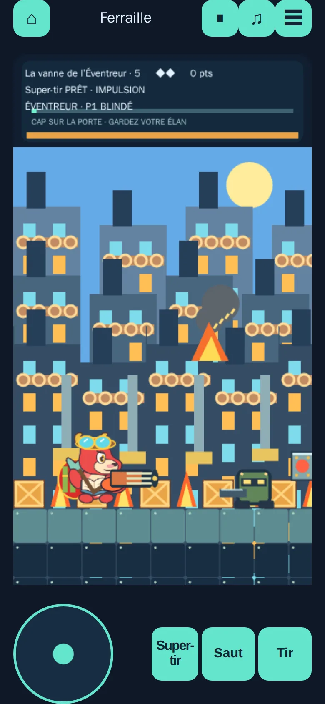<br><b>Ferraille</b><br>Run, jump and shoot through workshops and their guardians.</td>
<td align="center" width="33%">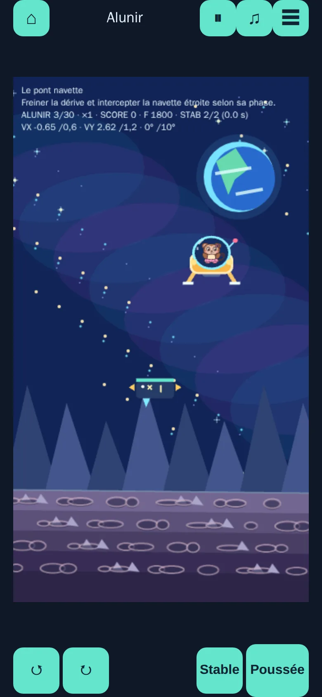<br><b>Alunir</b><br>Land the module gently, against gusts and with little fuel.</td>
</tr>
<tr>
<td align="center" width="33%">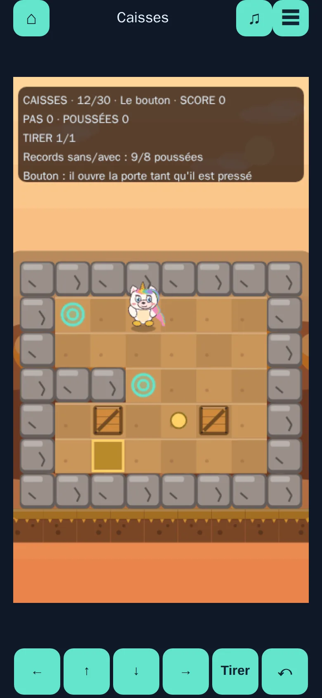<br><b>Caisses</b><br>Push crates onto their targets, with unlimited undo.</td>
<td align="center" width="33%">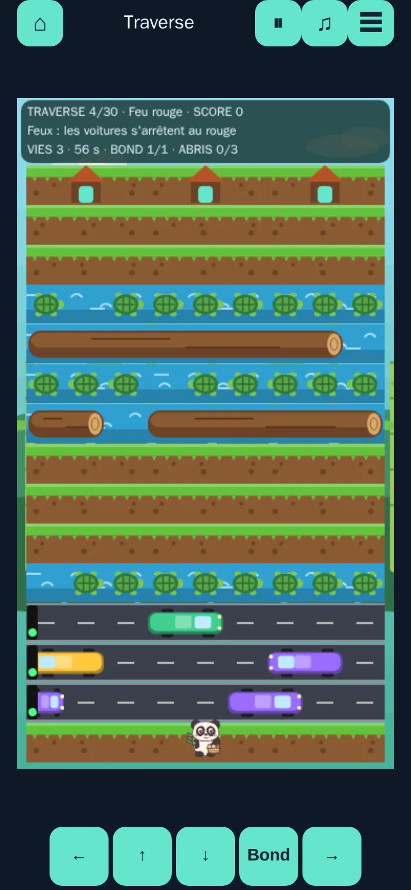<br><b>Traverse</b><br>Hop across traffic, logs and diving floats to the shelters.</td>
<td align="center" width="33%">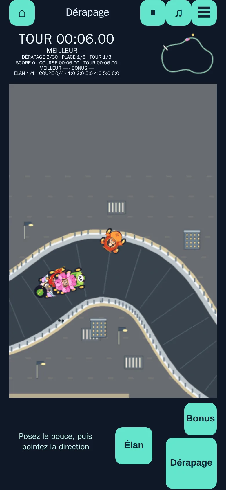<br><b>Pistouille</b><br>Drift a kart around 30 tracks and race for the podium.</td>
</tr>
<tr>
<td align="center" width="33%">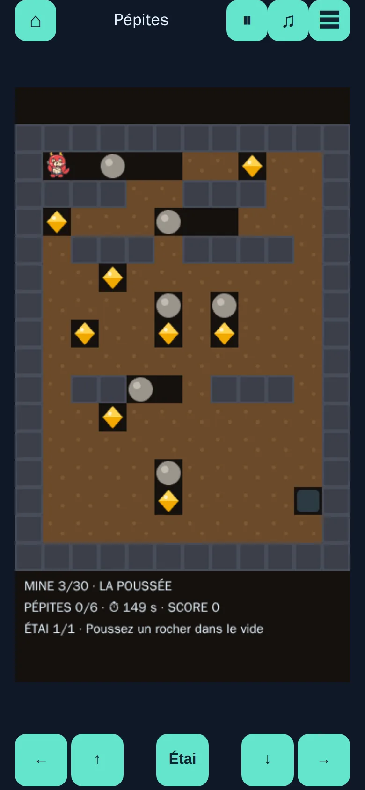<br><b>Pépites</b><br>Dig through the mine, dodge falling boulders and gather every nugget.</td>
<td align="center" width="33%">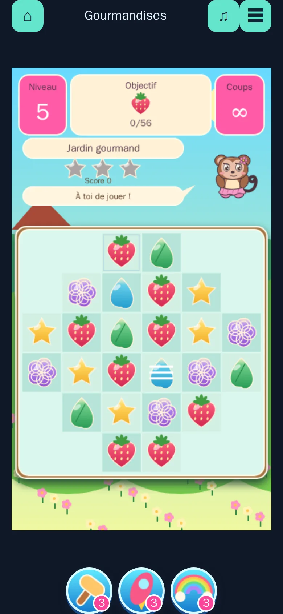<br><b>Gourmandises</b><br>Swap treats to line up three, across 240 levels and twelve worlds.</td>
<td align="center" width="33%">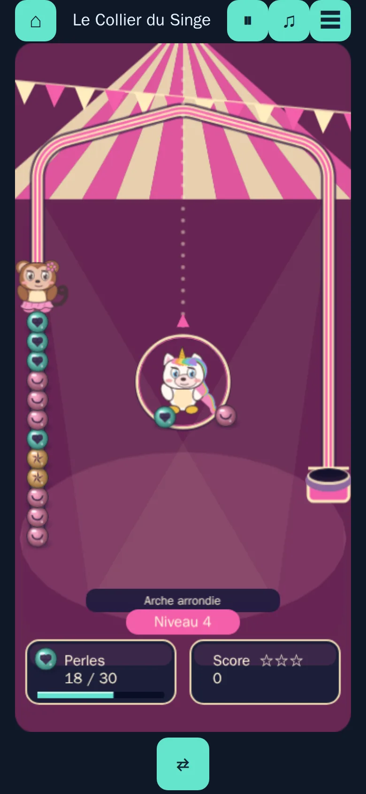<br><b>Le Collier du Singe</b><br>Shoot beads into the necklace before it reaches the basket.</td>
</tr>
<tr>
<td align="center" width="33%">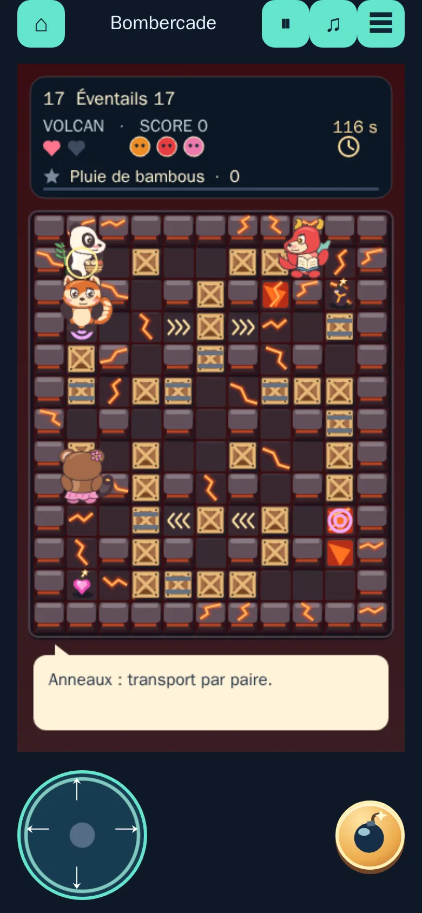<br><b>Bombercade</b><br>Drop bombs, blast crates and outlast your rivals in four arenas.</td>
<td align="center" width="33%">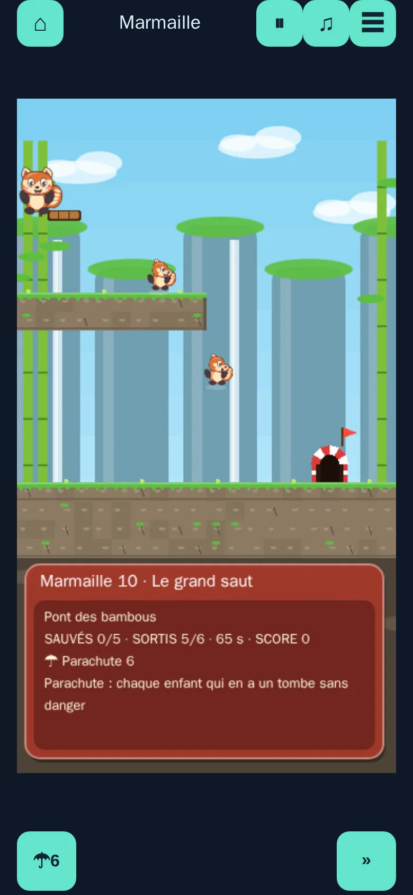<br><b>Marmaille</b><br>Hand out roles to a troop of kids and lead them safely to the exit.</td>
<td align="center" width="33%">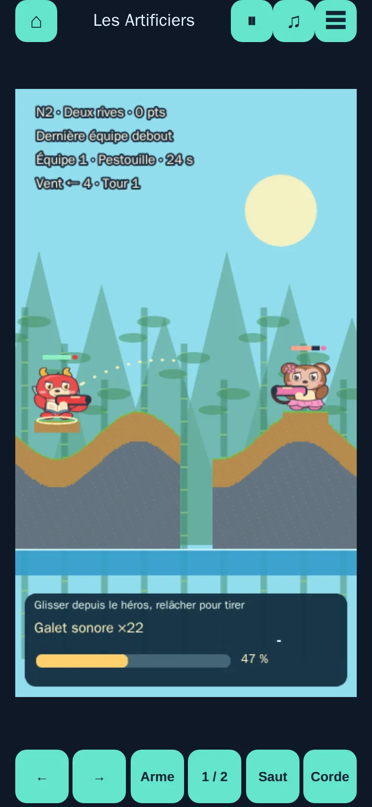<br><b>Les Artificiers</b><br>Turn-based artillery on destructible ground, with wind and a grappling rope.</td>
</tr>
</table>

## Games and controls

Bubble Lab now has precise hex snapping, gap shots, falling bonuses, and drag-to-aim/release-to-fire touch controls; ⇄ or X swaps the next bubble.

Bubble Lab now has 30 sculpted levels with stones, bombs, rainbow shots, ice, star rescues and internal bumpers. The table lists each game's
keyboard and touch controls. Mouse controls are listed where supported; you can
also click the on-screen controls. P or Escape pauses real-time games. Each game
includes its own help, and the mobile ☰ menu opens status, help, levels and restart
while pausing play.

| Game | How to play | Controls |
|---|---|---|
| **Le Collier du Singe** | 30 stages of moving pearl chains, magnetic retreats and combos. | Aim anywhere and release; tap shooter or ⇄/X: swap; arrows/Space: aim/fire; P/Escape: pause. |
| **Bombercade** | Thirty solo bomb mazes with breakable blocks, four arenas and the selected companion. | Arrows / ZQSD: move; Space: bomb; X: special; touch: directional pad, Bomb and power. |
| **Bubble Lab** | Match groups of at least three bubbles of the same color before the ceiling comes down. | Mouse: aim and fire; touch: drag and release; arrows: aim; Space: fire; touch buttons: adjust and fire. |
| **Serpentin** | Grow a glowing trail by collecting sparks and crystals, avoiding walls or wrapping around the board. | Arrows, ZQSD or WASD; touch: swipe or direction pad. |
| **Briqueterie** | 30 authored walls: sliding rows, blasts, regrowth, portals, chicanes, deflectors, keys, multiball, inverse gravity and hanging structures. | Mouse: guide the paddle; Left/Right or A/D: move; Space: launch; touch: drag along the bottom, tap or use Launch. |
| **Empilo** | Fit crystal pieces into a 9 × 16 well and complete rows, including sealed ones. | Left/Right/Down: move; X/W/Up and Z/C: rotate; Space: drop; touch: drag, tap to rotate, swipe down quickly to drop. |
| **Orbite** | Thirty formations with rotating shields, split probes, asteroids, gravity, stealth, repairers, satellite defense and coordinated swarms; six guardians and a two-phase finale. | Mouse: guide; Left/Right or A/D: move; Space: fire; touch: drag along the bottom and hold Fire, or enable auto-fire. |
| **Essaim** | Thirty tactical stages, six collectible weapons, rescue ships and six bosses. | Mouse: guide and fire; Left/Right or A/D: move; hold Space or Fire, release for a charged shot; touch: drag below the line. |
| **Dédale** | Gather maze seeds while evading four wisps, then turn the tables by collecting a sun. | Arrows or ZQSD; touch: swipe or direction pad. |
| **Ferraille** | Run, jump and shoot through workshops, facing a multi-phase guardian every five levels. | Left/Right or A/D: run; Up/W and Down/S: aim or crouch; Space/Z: jump; X/J: fire; touch: joystick, hold Jump and Fire. |
| **Alunir** | Land a lunar module gently while managing rotation, thrust and fuel over rough terrain and gusts. | Up/W: thrust; Left/Right or A/D: rotate; touch: hold the rotation and Thrust buttons. |
| **Caisses** | Push one to six crates onto targets, with unlimited undo and solver-proven records to beat. | Arrows or Q/S/D and Shift+Z: move; Z/Backspace: undo; R: restart; touch: swipe or direction pad, Undo button. |
| **Dévisso** | Take thirty screw-held assemblies apart: free screws go to the box of their colour or to a five-slot buffer, plates fall when empty; locks, crates, chains, rainbow, gold, TNT, gears, teleporters and ice. | Tap a free screw; boosts under the board (undo, hint, hammer, blast, drill); Enter: suggested screw; 1–5: boosts; Z: undo; H: hint; R: restart. |
| **Traverse** | Reach shelters across traffic, moving logs and diving floats. | Arrows or ZQSD: step; mouse click or touch tap: up; swipe or direction pad: step. |
| **Pistouille** (formerly Dérapage) | Steer a kart, charge drifts and race for the podium across seven original cups. | Arrows: absolute direction, including diagonals; Space/Shift: drift; X/Ctrl: bonus; touch: place a 360° joystick anywhere on the road view (10 px dead zone), point where to go, release to hold heading; Drift 88 px and Bonus 56 px; rotating camera and relative steering remain in ☰. |
| **Sudoku** | Fill every row, column and box with each digit once: 30 classic 9 × 9 grids, from clue-rich starters to X-wings, then a daily grid and an endless series. | Tap a cell, then a digit on the pad; pencil: notes; ↶: undo; bulb: explained hint; arrows, 1–9, Shift+digit: note, N, Delete/0, Ctrl+Z, H. |
| **Fusio** | Slide numbered tiles so equal ones merge: a classic 4 × 4 game towards 2048 that can go on after the win, then 30 seeded challenges (5 × 5 and 6 × 6 boards, stone cells, move limits, written starts) whose difficulty is measured by an expectimax agent. | Swipe, or the four arrow buttons; undo; bulb: explained hint; arrows or WASD, U/Backspace/Ctrl+Z, H, R. |
| **Démineur** | Clear every safe cell of a minefield: 30 grids from 6 × 6 to 16 × 16, each proved solvable without guessing (some mines draw a picture), then Beginner, Intermediate and Expert boards and a daily challenge. | Tap: dig or flag with the Dig/Flag switch; long press: the other tool; tap a complete number: open its neighbours; drag: move a large board; magnifier: overview; bulb: explained hint; arrows, Space/Enter, F, right click, T, H, Z, R. |
| **Bus en folie** | Empty a crowded bus yard: slide each bus along its lane to an exit, in the order of the waiting queue of passengers; 30 boards from 6 × 6 to 8 × 8 with parked cars, cones, coaches, coloured exits and one-way buses, each solved by the solver and holding a real trap. | Drag a bus along its lane (past the edge: it leaves); or tap a bus, then a free cell of its lane; undo, bulb: explained hint, restart; Tab/N, arrows, Z, H, R, Escape. |

Pistouille now has 30 hand-drawn layouts with cup themes, a full-width finish checker and geometry-based diversity checks.

Pistouille includes simulation-time race/lap clocks, best laps, coloured crossing deltas and per-circuit records retained across reloads. The mobile HUD stays above the road; race results include times and ranking. Z28/Z29 cover replay timing and resilient persistence.

Names, rules, levels, artwork and sounds are original. Graphics and synthesized
sounds are generated in code, with no external game assets, fonts or audio files.
The original PWA icons are also generated in code. Best scores, unlocked levels
and preferences use `localStorage` when available; play still works without it.
Existing `arcade-lab:*` and `bubble-lab:*` storage keys preserve earlier progress.

## Install on your phone and play offline

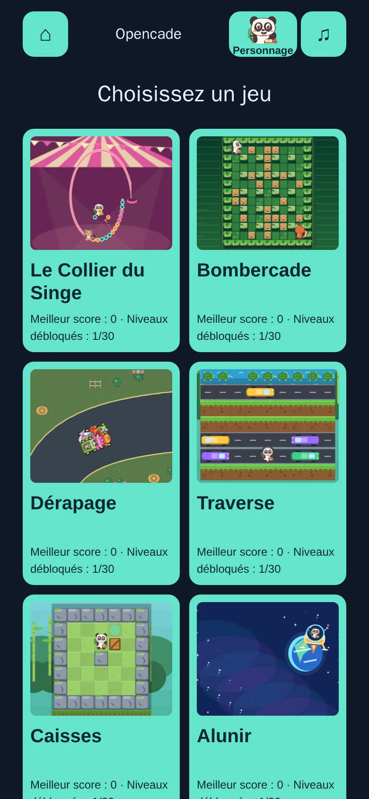

Open [the demo](https://davy45270.github.io/Opencade/) online and let the home
screen finish loading so every game can be cached.

- **Android / Chrome:** open the ⋮ menu and choose “Install app” or “Add to Home screen”.
- **iOS / Safari:** open Share, choose “Add to Home Screen” and confirm.

Launch Opencade from the new icon. Menu wording varies by browser version.
After the initial cache is ready, the home screen and every game work
offline. Scores, unlocked levels and settings stay in the browser or installed
app's local storage. Clearing that storage removes progress and may require
another online visit.

Updates are announced without interrupting a game. Close every Opencade window
and reopen to apply an available update. The service worker waits for the next
launch rather than forcing activation during play. All build HTML, JavaScript,
CSS and icons, including Phaser, are precached; there are no remote fonts,
third-party servers or external data caches.

## Phone comfort

Where supported, Opencade keeps the screen awake during active play and releases
it on pause, in the background or at the end of a level. Vibrations mark lost
lives, wins and defeats when global sound is enabled. The mobile menu offers
optional fullscreen and attempts portrait orientation. Unsupported or declined
features are silently skipped. See the device section of [GAME_SPEC.md](GAME_SPEC.md).

## Development

Use **Node 22.12 or later** (see `.nvmrc`).

```sh
npm ci
npm run dev        # development server
npm run lint       # oxlint with type-aware rules, no warnings allowed
npm run typecheck  # TypeScript without emitting files
npm test           # Vitest engine and shell tests
npm run build      # static site in dist/
npx playwright install --with-deps chromium
npm run test:e2e   # Playwright against the production build
node scripts/check-pwa-mutations.js # assertions PWA + huit mutations, sans navigateur ni Vitest
npm run preview    # preview dist/ over HTTP
```

The build is a standalone static site. Relative paths (`base: './'`) support
hosting at a domain root or under a subdirectory such as `/Opencade/`. Serve it
over HTTP, rather than opening files directly. The manifest and service worker
also use relative paths. The three shipped icons (192, 512 and 512 maskable) have
opaque backgrounds and a central design within the maskable safe area; building
requires no graphics tools.

Vitest checks game rules against fixed boards and seeds, using the rule IDs in
[GAME_SPEC.md](GAME_SPEC.md). Playwright covers desktop and touch-enabled mobile
Chromium, uses real inputs, and fails on page or console errors. The test-only
URL parameter `?test=1` exposes `window.__ARCADE_TEST__` and per-game hooks for
state inspection, levels, scenarios and `advance(ms)`. Advancing simulation time
keeps gameplay assertions independent of rendering speed. Hooks are absent
without the parameter. They are deliberately included in the published build so
E2E tests exercise the shipped product; changing a local game's state is not a
security boundary.

Finger playthroughs use stepped game time (fixed seed, noisy CDP touches and 150 ms game-time latency); performance is measured separately over five real seconds per game, with an advisory 30 FPS threshold enforced only by `PERF=1`.

GitHub Actions runs lint, typecheck, unit tests, build and E2E checks on pushes
and pull requests, and attaches a Playwright report on failure.

## Architecture

```text
src/
  engines/<game>/    pure rules, collisions, levels and scoring
  engines/shared/    seeded random number generator
  games/<game>/      Phaser scene, animation, input and synthesized sound
  games/registry.ts game list, help and declared controls
  shell/            shared input, pause, menus, levels, sound and storage
tests/              engine and shell unit tests
tests/e2e/          desktop and mobile browser journeys
```

Engines are pure TypeScript with no Phaser or DOM dependencies. oxlint forbids
browser globals and `Math.random` there. A seeded random number generator makes
the same inputs and seed produce the same game. Phaser scenes render engine
state and pass inputs to it. The shared shell recreates Phaser when switching
games and releases listeners on exit. To add a game, implement an original engine
and scene, then register it in `src/games/registry.ts`.

## Known limitations

- No online leaderboard or saving of an unfinished game.
- Canvas gameplay has no complete screen-reader representation; scores, status and buttons use HTML.
- Automated browser tests cover Chromium only.
- Vite reports a large Phaser bundle; this warning is expected.

## Credits

Code written by Codex (OpenAI), reviewed and checked by Claude (Anthropic),
under the direction of David Sevin.

## Contributing

Bug reports and pull requests are welcome in English or French. Read
[CONTRIBUTING.md](CONTRIBUTING.md), the [code of conduct](CODE_OF_CONDUCT.md)
and the [security policy](SECURITY.md) before contributing.

## License

[MIT](LICENSE) © 2026 David Sevin. Phaser is also MIT licensed.

Pistouille adds alternating slalom gates with time penalties, snow and downhill acceleration, banked BMX turns and jumps, and continuous urban rails.

Essaim validation (weapons, diversity, 60 campaign wins and mutations): `nice -n 19 ionice -c3 node scripts/validate-essaim.js`. E2E captures run on the test host.

Dédale pass 57 adds colored keys/doors, one-way passages, portals, switches, cyclic walls, ice and darkness across five seeded maze shapes. Thirty recorded solver routes and six mutation checks run with `nice -n 19 ionice -c3 node scripts/validate-dedale.js`; diversity drops from 100 to 22.4 (0% adjacent clones). See [the level table](GAME_SPEC.md#dédale).

Briqueterie (pass 61): recorded winning campaigns on seeds 455 and 28; browser-free validation with `nice -n 19 ionice -c3 node scripts/validate-briqueterie.js`. See `GAME_SPEC.md` for all thirty layouts and `docs/diversity.md` for measurements.

Orbite (pass 64): regenerate/check the 60 ordinary-input victories with
`nice -n 19 ionice -c3 taskset -c 0,1 node scripts/validate-orbite.js`
(`--record` to regenerate). Each unit test replays one short recording; long campaigns run only in Node.

Pistouille (pass 67) defaults to a north-up thumb joystick with visible heading, optional light assistance, non-sticky rails and a wide introductory circuit; records migrate by circuit name.

The home footer and ☰ menu show the running build; use “Forcer la mise à jour” to refresh the PWA without deleting game saves.

The companion selected at home now plays Caisses, Traverse and Alunir, with a tactical special and procedural character animation.

### Personnages

| Identifiant | Nom et sous-titre | Devise |
| --- | --- | --- |
| `panda` | **Boubou** — Panda glouton | « Manger, foncer, recommencer ! » |
| `pandaroux` | **CaliRoux** — Panda roux joueur et câlin | « Des câlins et des dérapages ! » |
| `dragon` | **Pestouille** — Dragon assidu | « Toujours plus loin, toujours plus fort ! » |
| `singe` | **Tutu** — Singe en tutu | « Des pirouettes plein la piste ! » |
| `licorne` | **Lumi** — Licorne joueuse | « La magie au service de la victoire ! » |

Le choix du personnage affiche son nom, son sous-titre et sa devise.

**Le Collier du Singe** (`collier`): 30 original chain-pearl stages; aim anywhere and release to shoot, tap the shooter or ⇄/X to swap. Node validation: `npm run test:node -- --only=validate-collier.js`.

**Pépites** (`pepites`): 30 original turn-based mines; dig soil, dodge falling and rolling boulders, push them aside, gather nuggets and reach the exit; directions on both thumbs, Étai freezes the rocks for twelve turns. Node validation: `npm run test:node -- --only=validate-pepites.js`.

Gourmandises adds 240 seeded match-three levels, two modes, cascading specials, golden cargo, double ice, spreading chocolate, trapped flowers, looping conveyors, rainbow portals between two boards, strawberries carried off floating islands and striped workshop bombs; five-seed balance, unchanged states for levels 1–180 and 87 in-memory mutation checks.

**Les Artificiers** (`artificiers`): thirty original turn-based terrain duels,
training targets and survival/structure missions across a green archipelago,
autumn cliffs and a volcanic basin. Drag from the active companion to aim and
release to fire. Short walks, jumps, a grappling line, six limited-ammunition
weapons, visible wind and rising water; solo against three AI skills or two
players sharing one phone. Node validation replays thirty recorded victories
and noisy touch victories on levels 1 and 10. All visuals and sounds are code.

**Dévisso** (`devisso`): thirty hand-drawn assemblies (car, rocket, owl, castle, snowman…) on up to three layers of plates, across six themes. A screw comes out only when no plate above covers it; it flies into the open box of its colour, otherwise into the buffer (five slots, a sixth opened by a gold screw). "Aucun coup possible !" when nothing fits: a heart takes the last three moves back. Each mechanism is introduced alone, then combined. Every level is won by the solver without boost, its recorded line and a real dead end are replayed by the engine: `npm run test:node -- --only=validate-devisso.js`. Drawings and sounds in code.

**Sudoku** (`sudoku`): 30 original classic 9 × 9 grids, from clue-rich starters needing hidden singles only to X-wings (each technique introduced alone), each proved unique by the solver and solvable by the explained hints alone; difficulty is measured by the hardest technique needed, never below the grid three levels before. Daily and endless grids are generated from a seed and kept only when their uniqueness is proved. Notes, unlimited undo, conflicts marked with a hatch and a “!” badge, and a companion that explains the next deduction. The clock is shown but never counted; stars depend on mistakes and hints. Node validation: `npm run test:node -- --only=validate-sudoku.js`.

**Fusio** (`fusio`): a pure engine following the received specification for a tile-merging game (one merge per tile per move, 2/4 spawn at 90/10 from the shared seeded generator and only when the board changed, events, a refused action never mutates anything, undo restores the generator too and can be disabled per challenge). The classic 4 × 4 game aims at 2048 and may continue after the win. Thirty fixed challenges vary one rule at a time (board size, spawn weights, stone cells, move limit, written start); their difficulty is the share of games lost by a noisy expectimax agent over 120 runs, frozen and re-measured in CI, never claimed winnable. The hint gives the agent's move and explains it in one sentence. Tiles differ by colour and by an emblem; reduced motion removes the animations. Node validation: `npm run test:node -- --only=validate-fusio.js`.

**Démineur** (`demineur`): a pure engine following the received specification (eight neighbours, breadth-first flood, flags, optional “?”, chord, a refused action never mutates anything, the first touch is always safe through deferred, seeded placement). Thirty progression grids from 6 × 6 to 16 × 16, in six board themes, start from an opening and are proved solvable without guessing by a frontier solver (one number, two numbers compared, bounded enumeration, global count; unknown on a limit, never a false claim); fifteen of them hide a drawing made of mines, shown on the win. Classic Beginner 9 × 9, Intermediate 16 × 16 and Expert 30 × 16 may need a guess and say so; the daily challenge is proved like the progression. The hint gives one proven deduction and explains it, or says honestly that none exists. Expert on a phone is shown rotated (16 × 30) and zoomed at 38 px cells, with drag and an overview magnifier. Node validation: `npm run test:node -- --only=validate-demineur.js`.

**Bus en folie** (`busfolie`, *Bus Frenzy*): a pure engine following the received specification (buses of two or three cells sliding on their axis only, parked grey cars, fixed cones, neutral or coloured border exits, a fixed and visible passenger queue boarding automatically by colour and seats, one-way buses; a refused action never mutates anything). Thirty frozen boards from 6 × 6 to 8 × 8, found offline by a seeded generator and a local search on a measured difficulty, introduce one mechanism at a time up to level 19; levels 20 to 30 add no new mechanism and grow by load (more cars, more buses, a fuller yard). A breadth-first solver proves each board (solved, unsolvable or unknown on a limit, never a false claim), finds its par and a trap on the shortest line, from level 1 on. After an irreversible move the game proves whether a winning line remains and says « Bloqué ! » only on proof. The hint gives the next move of a shortest line and explains it. Node validation: `npm run test:node -- --only=validate-busfolie.js`.
